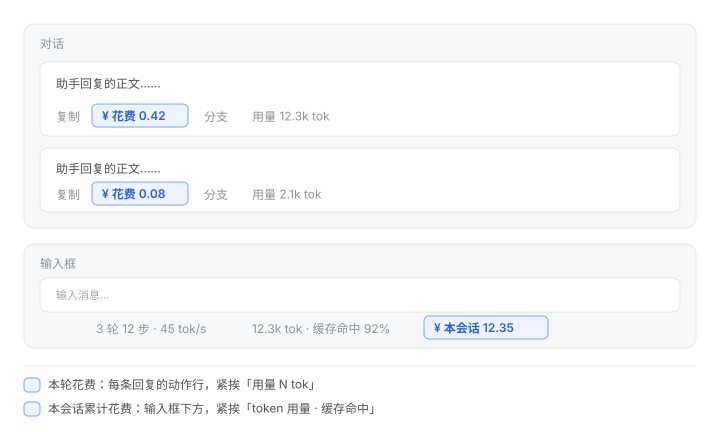

# dsh-session-cost —— 会话花费

把「这一轮花了多少钱」和「这个会话一共花了多少钱」直接摆在 token 用量旁边。

| 位置 | 显示内容 | 插槽 |
| --- | --- | --- |
| 每条回复的动作行，紧挨「用量 N tok」 | **本轮花费**，如 `¥花费 0.42` | `conversation.chat.assistant-actions` |
| 输入框下方，紧挨「token 用量 · 缓存命中」 | **本会话累计花费**，如 `¥本会话 12.35` | `conversation.composer.dock` |

两个入口都是**纯展示**：金额由 Host 侧算好后通过 DSH 的会话投影同步到浏览器，
客户端插件不做任何计价。



## 它怎么算钱

一次模型请求就是一次计费。折叠的口径是：

1. 每条 `assistant/message`、每条带 usage 的 `assistant/attempt` 都是一次真实
   请求，**各自累加**；`llm/retry-started` 之后的那次请求算作新的一次。
2. 每次请求用**它自己的路由**（provider/model）和**它自己发生的时刻**定价——
   会话中途换模型、或跨过峰谷切换点，总额都还准。
3. token 分三个互不重叠的桶计价：
   `未命中输入 + 缓存写入` × 未命中价 ＋ `缓存命中输入` × 命中价 ＋ `输出` × 输出价。
4. 查不到单价的模型**不猜价**：它的 token 计入「未计价」，界面显示成 `¥0.42+`，
   鼠标悬停会说明有多少 token 没算进去。所以金额永远是**下界**，不会虚高。

金额全程以**微元**（1 元 = 1,000,000 微元）整数累加。价格是「元 / 百万 token」，
所以 `微元 = token × 单价`——正好整除，既没有浮点漂移，也让投影的 wire schema
能用「非负整数」这一条硬约束卡住。

### 价目表

内置 DeepSeek 官方价目（元 / 百万 token，`[空闲, 高峰]`）：

| 模型 | 缓存命中 | 缓存未命中 | 输出 |
| --- | --- | --- | --- |
| `deepseek-flash`（含旧名 `deepseek-v4-flash`、`deepseek-v4-flash-vision-exp`） | 0.02 / 0.04 | 1 / 2 | 4 / 8 |
| `deepseek-v4-pro` | 0.15 / 0.30 | 4.5 / 9.0 | 13.5 / 27.0 |

来源：<https://api-docs.deepseek.com/zh-cn/quick_start/pricing>

峰谷规则同样照官方脚注实现：**北京时间周一至周五（不含中国法定节假日）
9:00–12:00 与 14:00–18:00 为高峰，其余时段（含周末与中国法定节假日全天）为空闲**。
内置 2026 年放假日表；跨年后用 `holidays` 配置自行下发，或关掉 `peakPricing`
一律按空闲价。

## 安装

### 打包成 tgz 安装（推荐）

打包产物按本机约定交付到**桌面的插件文件夹** `~/Desktop/插件/`，profile 则从工作区
里那份同名 tgz 安装（`file:` 依赖在安装时要能读到源文件，所以两份都得在）：

```bash
cd dsh-session-cost
pnpm pack --pack-destination ..                                  # 产物：../dsh-session-cost-<version>.tgz
cp -f ../dsh-session-cost-<version>.tgz ~/Desktop/插件/           # 交付副本

dsh plugin --profile desktop add file:$PWD/../dsh-session-cost-<version>.tgz
```

装好后 `~/.dsh/profiles/desktop/node_modules/dsh-session-cost/` 是一份**真实目录**
（不是符号链接），插件不再依赖工作区路径，`npm test` 在装好的那份里也能直接跑。

> ⚠️ 这样装之后，**改工作区里的源码不会再影响已装的插件**。要更新得改工作区 → 重新
> `pnpm pack` → 再 `dsh plugin … add file:…tgz` 一次。
>
> ⚠️ 重装时记得**同时改 `version`**。pnpm 是按「路径 + 版本」缓存 `file:` 依赖的：
> 版本号不变时，它会认为已装的包就是最新的，新 tgz 解包了却不会重新链接，
> `node_modules/dsh-session-cost/` 里还是旧内容。锁文件里记着 tgz 的 integrity，
> 所以**装好之后不要再原地重新打包**同一个版本号，否则下次 `pnpm install` 会撞哈希。

### 目录链接安装（改代码即时生效）

```bash
dsh plugin --profile desktop add link:/绝对路径/dsh-session-cost
```

或手工写进 `~/.dsh/profiles/<profile>/package.json`：

```jsonc
{
  "dependencies": { "dsh-session-cost": "link:/绝对路径/dsh-session-cost" },
  "dsh": { "profile": { "bundles": [/* … */, "dsh-session-cost"] } }
}
```

两种装法装好后**刷新页面**即可。Host 半边注册投影、浏览器半边注册两个 slot 入口；
插件卸载时投影键随之消失，界面上的两个数字会自行隐藏。

> 改动 Host 半边的源码后需要**重启应用**才生效（模块被 Node 的 ESM 缓存持有，
> 停用再启用同一条目不会重新求值）；只改 `client.js` 则刷新页面即可。

## 配置

在 `cordis.patch.yml` 或 profile 的 patch 层里覆写：

```yaml
- id: session-cost
  config:
    currency: CNY        # 只影响显示符号
    peakPricing: true    # 关掉则一律按空闲时段价
    prices:              # 覆盖/补充内置价目表；match 是模型名子串
      - match: my-model
        hit: 0.5
        miss: 10
        out: [20, 40]    # 单值 = 峰谷同价；两元组 = [空闲, 高峰]
    defaultPrice:        # 都没命中时的兜底价；不配置则记为「未计价」
      hit: 0.05
      miss: 1
      out: 4
    holidays: ['2027-01-01']  # 完全替换内置节假日表
```

`prices` 的 `match` 按**最长关键字优先**匹配，所以 `pro` 这样的短关键字不会抢走
更长模型的匹配。

## 设计要点

**为什么是会话投影。** DSH 的界面读会话数据只有一条正规通道：session projection。
注册一个纯 fold，框架负责折进每个会话、随 control 流同步到浏览器、变化时通知；
客户端 `useProjection('sessionCost')` 即可。这样不需要自建 HTTP 路由、不需要轮询，
也不需要客户端插件里再存一份会漂移的状态。

**为什么「本轮花费」要靠 flex order 摆位。** 回复动作行只开放了一个扩展点
（`conversation.chat.assistant-actions`，即 `MessageIconActions` 的 `extraActions`），
而它的 DOM 顺序是 `复制 → extraActions → 反馈 → 分支 → 用量`——插件天然排在「用量」
**前面**，也就是夹在左边那组图标中间。要真的贴到「用量」右边，只能靠 flex `order`：

1. 给自己一个 `order: 8`，先确保落在右侧那一簇的末尾（这一条不依赖任何内部类名，
   是兜底）；
2. 「用量 N tok」与时间被包在同一个 `span` 里，所以再加一条
   `[data-turn-tail] [class*='_endInfo'] { display: contents }` 把它摊平，让两者成为
   动作行的直接 flex item，然后给时间 `order: 9`，就得到
   **用量(0) → 花费(8) → 时间(9)**，真正贴着「用量」。

第 2 步的选择器只用 CSS Modules 类名的稳定半边（`<hash>_endInfo` 的哈希随构建变，
`_endInfo` / `_timeEnd` 来自源码类名），并且 `display: contents` 丢掉的
`margin-left` / `min-width` / 颜色都在同一条规则里补了回来。上游改名时这两条规则
只是不生效，第 1 步仍然兜住位置，不会显示错乱。

**为什么输入框那枚胶囊要自己写死字号。** dock 那一行本身不设 `font-size`，继承下来
是正文的 14px，而内置胶囊（`StatsPills`）把字号降到了 `secondary - 1px`（约 12px）。
所以 `.dsh-cost-pill` 必须逐字照抄内置的三个值（字号、行高、`tabular-nums`），否则
会比旁边大一号——这一条已经写进测试防回归。

**为什么金额按 messageId 反查轮次。** 每条回复的动作行这个插槽只交给插件一个
`messageId`，而金额是按轮次聚合的，所以投影里同时带一份 `messages`（messageId →
turn）索引。

**为什么 Host 半边零依赖。** profile 侧插件是以符号链接挂进
`~/.dsh/profiles/<profile>/node_modules/` 的，Node 按真实路径解析依赖，
`@deepseek-ai/*`（只在 app.asar 内）和 `zod`（在 profile 根）都可能解析不到。
计价与配置校验都是正确性核心，不能靠这种运气，所以 Host 半边只 import 相对路径：

- 计价内核（`lib/pricing.js`）是纯函数；
- 投影的 `stateSchema` / `viewSchema` 用自带的一份「只实现 `parse`」校验器
  （`lib/schema.js`，运行期契约确实只有 `.parse()`）——它是恢复持久化缓存时的
  唯一防线，必须永远可用；
- 插件 `Config` 直接实现 **Standard Schema**（`lib/config.js`）。Cordis 解析配置的
  唯一契约就是 `Config["~standard"].validate(config)`；自己实现它，既拿到与 zod
  同等的校验与默认值，又不用赌某个包能不能解析到。

  一个容易踩的坑：**`Config` 一旦导出就必须带 `~standard`**——Cordis 只看
  `runtime.Config` 存不存在，随后立刻取该字段；导出没有它的对象会让插件在带配置
  时直接抛错。导出 `undefined` 才是「跳过校验」。

  代价：配置面板的 JSON Schema 投影只认原生 schemastery 标记，本插件会显示为
  `unsupported`（“声明了 schema，但不是原生那种”）；校验与默认值照常生效。

**为什么浏览器半边是手写的。** DSH 客户端插件按 `exports["./client"]` 取文件，
内容必须是 `window.__ModuleLoader__.load({ id, factory })`。手写这层包裹让插件保持
零依赖、零构建：只 `require('react')`（启动期平台种子模块），样式用一段注入的
CSS，视觉规格逐条对齐内置胶囊，所以并排时不显得是外来的。

**与内置口径的两处刻意差异**（都是为了让金额更接近真实账单）：

1. attempt 缺路由时，内置界面不显示该轮的模型行；本插件回落到「本会话最近一次
   已知路由」继续计价。重试几乎总落在同一个模型上，这比丢掉这段 token 更准。
2. 内置 fold 在事件生命周期不自洽时会整轮不展示用量；本插件一律累加
   `assistant/message` 的用量。漏算一次成功请求比多算更糟，而且真实日志里
   `assistant/attempt` 之后直接跟同 step 的 `assistant/message` 一次都没出现过。

## 验证

```bash
node --test lib/index.test.js client.test.js
```

除单元用例外，`lib/index.test.js` 会把本机 `~/.dsh/sessions` 里的**全部真实会话
日志**（zstd 多帧 JSONL）解码后喂进 fold，与一个**独立写的参考实现**逐会话对账，
并核对每条 `assistant/message` 都留下了 messageId → turn 映射、最终状态能通过
投影自己的 schema。当前实测：19 个会话、1841 条 assistant/message，
fold 与参考实现完全一致。目录不存在时这一层自动跳过。

装好之后还可以这样确认 Host 半边真的在跑：`~/.dsh/storages/session_projcache/sessions/<会话 id>.json`
里会出现一个 `sessionCost` 行。把它与「把同一份会话日志重放到 `foldSessionCost`」
的结果比对，应当逐微元相等（本机实测：seq 1397 时投影与重放同为 1,873,091 微元
= ¥1.8731）。

## 装上之后

1. **刷新页面**（⌘R）。Host 半边在插件插入运行时就已生效，但浏览器要重新拿一次
   启动清单才会加载新的客户端 bundle。
2. 打开任意一个已有用量的会话：输入框下方应出现「¥ 本会话 x.xx」，每条回复的
   动作行应出现「¥ 花费 x.xx」（鼠标悬停有口径说明）。
3. 改代码后需要**重启应用**才生效：插件模块由 Node 的 ESM 缓存持有，停用再启用
   同一条目不会重新求值模块。

## 已知边界

- 会话中途换模型时，若某次请求恰好既没有路由、本会话此前也没有任何已知路由，
  这段 token 会记为「未计价」（不会猜价）。
- 峰谷按**请求发起时刻**判定（`step/start` / `llm/retry-started` 的时间戳）。
  一次跨过峰谷切换点的长流式响应，按发起时刻计价——这与服务端按请求时刻计费一致。
- 非 DeepSeek 模型需要自行配置 `prices` 或 `defaultPrice`，否则显示为「未计价」。

## 许可

MIT
